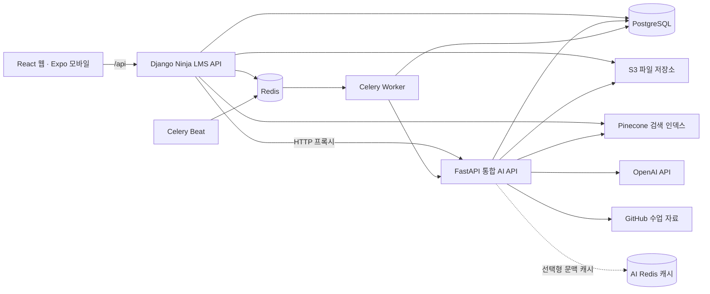

# 시스템 아키텍처

현재 저장소의 코드와 Compose 설정을 기준으로 서비스 경계를 정리한다. AWS 리소스의 실제 가동이나 운영 배포 완료를 확인한 문서는 아니다.

## 서비스와 요청 흐름

- React는 `/api`로 요청한다. Django는 JWT 인증, 사용자·기수·소유권 검사와 LMS 업무 데이터를 담당한다.
- FastAPI는 학생 챗봇, 공부방 노트·복습 문제, 이력서 첨삭, 채용공고 추천을 하나의 통합 앱에 연결한다. Django와 별도 프로세스·이미지로 실행한다.
- AI 요청은 Django가 확인한 사용자 문맥을 전달한다. 학생 챗봇과 공부방 내부 프록시는 `LMS_AI_SHARED_TOKEN`을 사용하며, 기능별 권한 검사는 해당 API 코드가 기준이다.
- 학습 자료는 GitHub API·저장소에서 읽는다. 공고 수집 코드는 채용 데이터를 PostgreSQL `jobs` 스키마에 저장하고 Pinecone 검색 인덱스를 구성한다.

| 기능 | Django 공개 경로 | FastAPI 내부 경로 |
|---|---|---|
| 학생 챗봇 | `/api/chat`, `/api/chat/stream` | `/api/v1/student-chatbot/chat`, `/api/v1/student-chatbot/chat/stream` |
| 공부방 | `/api/study-notes/*`, `/api/practice-*` | `/api/v1/study-notes/proxy/*` |
| 이력서 첨삭 | `/api/resume-review/*` | `/resume-review/api/v1/resumes/*` |
| 채용공고 | `/api/jobs/*` | `/api/v1/jobs/*` |

근거: [통합 AI 앱](../../cover_letter_rag/app/integrated.py), [Django API](../../lms_api/lms/api.py), [공부방 프록시](../../lms_api/lms/study_note_service.py), [GitHub 연동](../../study_notes/github.py).

## 저장소와 비동기 처리

| 구성 | 현재 역할 |
|---|---|
| PostgreSQL | 사용자·기수·학습·출결·지원서·첨삭의 원본 데이터이다. LMS 모델은 `public`, 수집 공고는 별도 `jobs` 스키마에 둔다. |
| S3 | 증빙·이미지·문서 등 파일을 저장한다. DB에는 `storage_key`를 보관하고 읽을 때 만료되는 서명 URL을 발급한다. S3 미설정 로컬 환경은 `lms_api/media`를 사용한다. |
| Pinecone | 정책·공지·프로젝트 자료와 채용공고의 벡터 검색 인덱스이다. 관계형 테이블이나 원본 업무 DB를 대체하지 않는다. 공고 인덱스 기본 이름은 `job-posting`이다. |
| Redis | Celery broker/result backend와 첨삭 작업 상태·잠금에 사용한다. AI 문맥 캐시는 별도 선택형 설정이며 기본으로 켜지지 않는다. |
| Celery Worker / Beat | 예약 공지 발행, 수업 저장소 동기화, 복습 문제 자동 출제, 자격시험 일정 동기화, 첨삭 checkpoint 후속 작업을 처리한다. |

Beat 기본 주기는 예약 공지 60초, 수업 저장소 동기화 1시간, 복습 문제 매일 18:30, 자격시험 일정 매일 05:10이며 시간대는 `Asia/Seoul`이다. 공부방 노트 생성은 Django의 백그라운드 스레드를 사용하므로 모든 비동기 작업이 Celery 큐를 거치는 구조는 아니다.

AI 문맥 캐시는 [선택형 Compose overlay](../../deploy/docker-compose.chat-cache.yml)를 추가하고 `LMS_CHATBOT_WARMUP=1`로 켤 수 있다. TTL은 300초이며 조회 시 DB 권한·데이터 변경을 다시 확인한다. 이 캐시는 호스트 포트를 공개하지 않는다.

S3·Pinecone·Redis는 ERD의 테이블이 아니다. `resumes.linked_job_id`, `applications.job_id` 같은 공고 ID 문자열은 논리 참조이며 PostgreSQL FK와 구분한다. Neo4j와 범용 Outbox projector는 현행 실행 구성에 포함하지 않는다.

근거: [Django 모델](../../lms_api/lms/models.py), [공고 SQL](../../scripts/firestore_to_postgres/jobs_schema.sql), [파일 저장](../../lms_api/lms/storage.py), [Celery 설정](../../lms_api/lms_server/settings.py), [작업 등록](../../lms_api/lms/tasks.py), [첨삭 작업](../../lms_api/lms/review_jobs.py), [문맥 캐시](../../chatbot/context_cache.py), [공고 인덱스](../../job_matching_bot/retrieval/pinecone_index.py).

## 실행 포트와 배포 설정

| 환경 | 코드에 정의된 연결 |
|---|---|
| 로컬 개발 | React Vite `5173` → Django `8000` → FastAPI `8001`이다. Vite `/api` 프록시 기본 대상은 `127.0.0.1:8000`이다. |
| 로컬 Compose | PostgreSQL 16 `5432`, Redis 7 `6379`, Django `8000`, Celery worker/beat를 실행한다. AI 서비스는 이 Compose에 포함하지 않는다. |
| 단일 호스트 배포 설정 | 루트 `docker-compose.prod.yml`이 `api`, `ai`, `redis`, `worker`, `beat`, `nginx`를 구성한다. Django·AI 컨테이너는 각각 내부 `8000`을 사용하고 Django의 AI 대상은 `http://ai:8000`이다. |
| 2-EC2 배포 초안 | Django 호스트는 Nginx·API·Redis·worker·beat를 실행한다. AI 호스트는 `8001:8000`을 매핑하며 Django는 AI의 private 주소 `:8001`로 연결한다. |

배포 설정의 Django는 Gunicorn 3 workers/4 threads, AI는 Uvicorn 2 workers이다. Nginx는 `80`의 `/api/` 요청을 `api:8000`으로 전달한다. Compose에 `443` 매핑이 있으나 현재 Nginx 파일에는 TLS 설정이 없으므로 HTTPS가 완성된 구성으로 설명하지 않는다.

2-EC2 초안의 웹 정적 파일 경로는 S3 + CloudFront이다. 웹에서 API에 도달하려면 `VITE_API_BASE`에 API 주소를 지정하거나 CloudFront `/api/*` 오리진을 연결해야 한다. 실제 리소스 생성, 도메인·HTTPS와 네트워크 정책 적용 여부는 이 저장소만으로 확인하지 않는다.

근거: [Vite 프록시](../../lms_react/vite.config.ts), [로컬 Compose](../../docker-compose.yml), [단일 호스트 Compose](../../docker-compose.prod.yml), [Django 호스트 Compose](../../deploy/docker-compose.django.yml), [AI 호스트 Compose](../../deploy/docker-compose.ai.yml), [Nginx](../../deploy/nginx/nginx.conf), [배포 초안](../../deploy/DEPLOYMENT.md).

## CI와 미연결 배포 단계

[GitHub Actions](../../.github/workflows/deploy.yml)는 `main` push 또는 수동 실행으로 웹 의존성 설치·테스트·빌드와 Django/AI Docker 이미지 빌드를 수행하도록 정의한다. S3 업로드, ECR push, EC2 갱신 단계는 현재 안내 문구를 출력하는 `echo`이다. 따라서 자동 빌드 설정과 AWS 자동 배포 완료를 구분한다.

이 문서는 코드·설정 정합성만 확인한다. 실행 중인 클라우드 리소스, migration 적용 상태, 외부 API 자격증명과 배포 성공 이력은 검증하지 않았다.
