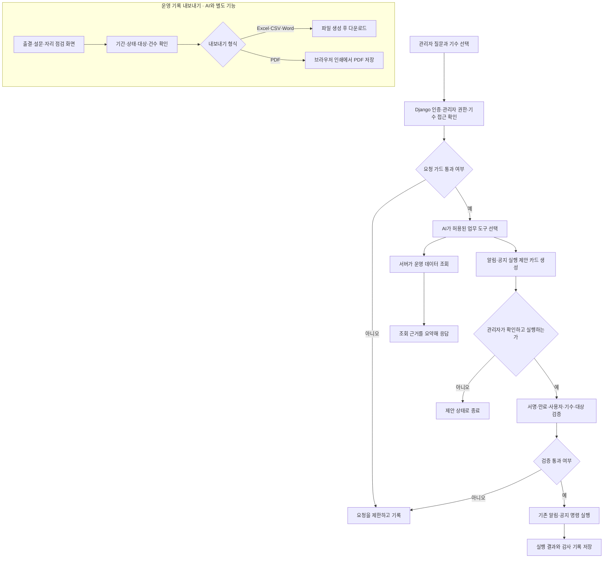

# 관리자 AI 도우미·운영 기록 아카이빙

자연어로 학생·출결 현황을 조회하고, 알림 발송과 공지 등록을 제안한다.

## 입출력

| 항목 | 명세 |
| --- | --- |
| 사용자 | 관리자 |
| 입력 | 선택한 기수, 운영 업무 질문, 최근 대화 |
| 근거 | 해당 기수의 학생·출결·처리 대기 항목·공지·알림 데이터 |
| 출력 | 조회 결과 요약, 관리자가 확인할 알림·공지 실행 카드 |

## 기능 흐름도

## 흐름 설명

1. Django가 관리자 로그인과 선택 기수 접근 권한을 확인한다. 제한 대상 요청은 도구 조회 전에 거절한다.
2. 허용된 질문은 AI가 조회 도구를 고르고, 서버가 실제 LMS 데이터를 읽어 요약 근거로 돌려준다.
3. 알림·공지 요청은 서명된 제안 카드로 반환한다. 실행은 관리자가 확인한 뒤 별도 API를 호출해야 하며, 서버는 제안의 만료·사용자·기수·대상과 중복 실행 여부를 검사한 다음 기존 명령을 실행한다.
4. 기록 내보내기는 AI 대화와 별개로 동작한다. 관리자는 표의 범위와 건수를 확인한 뒤 파일을 생성한다.

## 주요 규칙

- 조회 결과를 근거로 답하며, 운영 업무와 무관한 요청은 제한한다.
- 알림 발송·공지 등록은 관리자 확인 후 실행한다. 제안 단계에서는 처리 완료로 안내하지 않는다.
- 실행 제안은 서명과 유효기간, 사용자·기수 정보를 검증한다.

## 운영 기록 아카이빙

출결 신청·설문 결과·불시 자리 점검·교시별 착석 확인 기록은 해당 관리 화면에서 표로 내려받는다. AI 실행 카드와 분리된 화면 기능이며, 선택한 조회 범위가 내보내기에 적용된다.

| 대상 | 내보낼 범위 |
| --- | --- |
| 출결 신청 | 기간·처리 상태·이름으로 거른 목록 |
| 설문 결과 | 선택한 설문의 응답 목록 |
| 불시 자리 점검 | 선택한 날짜 범위 전체 또는 개별 점검 |
| 교시별 착석 확인 | 선택한 날짜 범위 전체 또는 개별 교시 기록 |

Excel·CSV·Word 파일을 생성하며 PDF는 브라우저 인쇄 창에서 저장한다. 내보내기 전 화면의 범위와 건수를 확인한다.

## 주요 API

| 메서드 | 웹 API | 용도 |
| --- | --- | --- |
| POST | `/api/admin/assistant` | 운영 조회·실행 제안 |
| POST | `/api/admin/assistant/execute` | 확인한 제안 실행 |

## 구현 근거

- [조회·제안·실행](../../lms_api/lms/admin_assistant.py)
- [요청·학생 입력 검증](../../lms_api/lms/admin_assistant_guard.py)
- [Django API](../../lms_api/lms/api.py)
- [내보내기 메뉴](../../lms_react/src/features/export/ExportMenu.tsx) · [파일 생성](../../lms_react/src/features/export/tableExport.ts)
- [출결 신청](../../lms_react/src/features/attendance/AttendanceRequestsPanel.tsx) · [설문 결과](../../lms_react/src/features/forms/AdminFormScreens.tsx)
- [자리 점검](../../lms_react/src/features/manager/SpotCheck.tsx) · [착석 확인](../../lms_react/src/features/admin/RollCallRecords.tsx)

[테스트 계획 및 결과](../reports/test_report_admin_assistant.md)

[README로 돌아가기](../../README.md#features)
