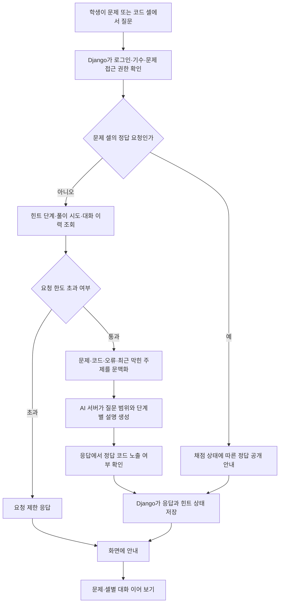

# 연습장 AI 코드 튜터

연습장의 문제·코드·오류를 바탕으로 단계별 힌트와 설명을 제공한다.

## 입출력

| 항목 | 명세 |
| --- | --- |
| 사용자 | 연습장을 이용하는 로그인 사용자 |
| 입력 | 질문, 문제 또는 코드 셀, 작성한 코드·오류, 힌트 요청 |
| 근거 | 문제 내용·검증 정보, 본인 시도 횟수·통과 여부, 해당 셀 대화와 최근 학습 기록 |
| 출력 | 단계별 힌트, 코드·오류 설명, 정답 확인 방법 안내 |

## 기능 흐름도

## 흐름 설명

1. Django가 로그인 사용자와 문제 세트의 기수·소유권을 확인한다. 셀 질문은 코드와 실행 오류를 받고, 문제 질문은 문제 내용·풀이 횟수·통과 여부를 추가한다.
2. 문제의 정답 요청은 AI를 호출하지 않고 현재 채점 상태와 공개 규칙을 안내한다. 추가 힌트 버튼을 누른 경우에만 서버가 힌트 단계를 올리며, 최대 3단계까지 제공한다.
3. 일반 질문은 최근 대화와 필요한 문제·코드 문맥을 AI 서버에 보낸다. AI가 만든 답변은 정답 코드 노출 여부를 확인한 뒤 저장한다.
4. 튜터 대화는 일반 셀 또는 문제별로 저장한다. 다시 열면 해당 문맥의 기록과 힌트 단계부터 이어 간다.

## 주요 규칙

- 힌트 단계는 서버가 관리하며, 명시적인 추가 힌트 요청으로만 올라간다.
- 코드 문제 모범답안은 통과했거나 2회 채점한 뒤 문제 화면에서 확인하도록 안내한다.
- 개념·출력 예상 문제는 제출 후 정답과 해설을 확인한다.
- 학습과 무관한 질문을 제한한다. 모범답안·숨긴 테스트를 담은 내부 튜터 요청은 학생용 문제 응답과 분리한다.
- 학생 LLM 호출은 분당 5회·하루 80회로 제한한다. 강사·관리자 역할은 이 호출 한도를 적용하지 않는다.
- 최근 10분 안에 범위 밖 응답이 3회 연속 누적되면 이후 범위 밖 질문은 LLM을 호출하지 않고 안내한다.

## 주요 API

| 메서드 | 웹 API | 용도 |
| --- | --- | --- |
| POST | `/api/practice-tutor` | 질문·추가 힌트 |
| GET | `/api/practice-tutor` | 대화·힌트 상태 조회 |
| DELETE | `/api/practice-tutor` | 새 대화 시작 |

## 구현 근거

- [튜터 상태·권한·정답 안내](../../lms_api/lms/practice_tutor.py)
- [힌트·설명 프롬프트와 답안 노출 검사](../../study_notes/practice/tutor.py)
- [튜터 화면](../../lms_react/src/features/practice/TutorPanel.tsx)
- [Django API](../../lms_api/lms/api.py)

[README로 돌아가기](../../README.md#features)
