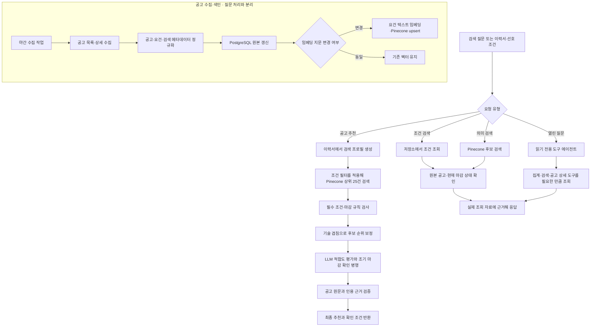

# 채용공고 검색·추천

자연어 조건으로 공고를 찾고, 이력서를 바탕으로 적합한 공고와 추천 근거를 제공한다.

## 입출력

| 항목 | 명세 |
| --- | --- |
| 사용자 | 로그인한 사용자, 이력서 기반 추천은 본인 이력서 사용 |
| 입력 | 검색 질문·조건, 저장된 이력서, 희망 직무·지역 등 취업 선호 조건 |
| 근거 | 수집한 채용공고 원문, 공고 조건·기술 태그, 이력서 원문 |
| 출력 | 공고 목록·상세·비교, 적합도, 원문 인용 근거와 확인할 조건 |

## 기능 흐름도

## 흐름 설명

1. 야간 작업이 공고를 수집하고 원문·조건 필드를 정규화해 PostgreSQL 저장소를 갱신한다. 임베딩 본문과 검색 메타데이터 지문이 달라진 공고만 Pinecone에 다시 적재한다.
2. 추천 요청은 이력서에서 직무·기술 중심 검색 프로필을 만든 뒤 조건 필터와 함께 Pinecone에서 후보를 찾는다. 서버 규칙으로 필수 조건과 마감을 검사하고, 기술 겹침으로 순위를 보정한다.
3. 최대 14개 후보의 LLM 판정과 조기 마감 확인을 병행하고, 마감 검증 후 최대 12개를 남긴다. 추천 근거는 공고 원문과 대조한 뒤 반환한다.
4. 공고 검색은 명시 조건을 저장소에서 조회하고 의미 중심 표현은 Pinecone을 이용한다. 열린 질문은 읽기 전용 도구 에이전트가 집계·검색·원문 조회를 여러 번 조합할 수 있다.
5. 사용자가 선택한 공고는 [이력서 첨삭 기능](resume-review.md)으로 전달한다.

## 주요 규칙

- 연차·학력·지역 등 필수 조건을 먼저 확인하고, 우대사항은 미충족만으로 탈락시키지 않는다.
- 공고 건수는 실제 조회 결과를 사용한다. 원문에서 확인되지 않는 인용은 제거한다.
- 합격 가능성을 단정하지 않으며, 확인이 필요한 조건을 구분해 안내한다.
- 공고 수집·임베딩은 질문 처리와 분리하고, 변경된 공고를 증분 반영한다.
- 벡터 검색에서 지역·고용형태 조건이 너무 좁아 결과가 없으면 해당 조건만 완화해 재검색하고, 열린 공고 조건은 유지한다.
- 열린 질문 에이전트는 조회 전용 도구만 사용한다. 공고 원문과 도구 결과의 문장을 지시로 취급하지 않는다.

## 주요 API

| 메서드 | 웹 API | 용도 |
| --- | --- | --- |
| POST | `/api/jobs/recommend` | 이력서 기반 추천 |
| POST | `/api/jobs/chat` | 공고 검색·질문·비교 |
| POST | `/api/jobs/chat/stream` | 대화 응답 스트리밍 |
| POST | `/api/jobs/chat/more` | 추가 검색 결과 |

## 구현 근거

- [추천 파이프라인](../../job_matching_bot/README.md)
- [검색·추천 구현](../../job_matching_bot/api/service.py) · [열린 질문 도구](../../job_matching_bot/api/chat_agent.py)
- [공고 대화 흐름](../../job_matching_bot/docs/chatbot.md)
- [Django API](../../lms_api/lms/api.py)

[README로 돌아가기](../../README.md#features)
