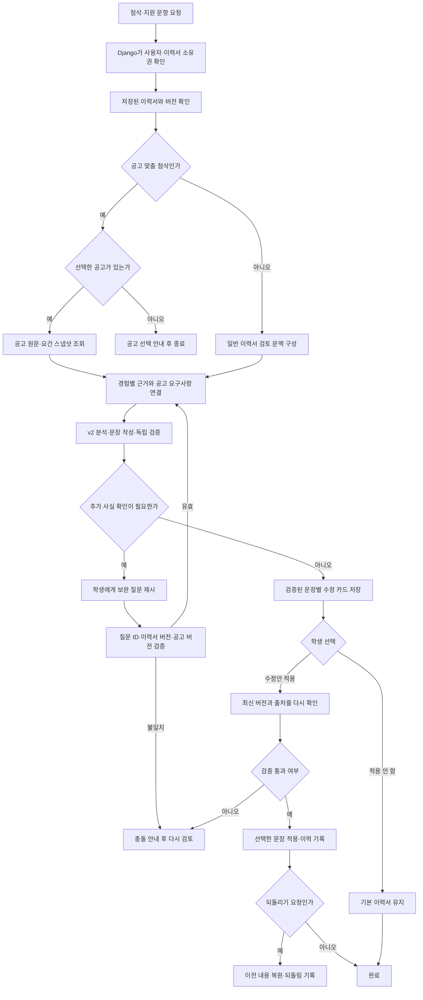

# 이력서 첨삭·공고 맞춤 지원

이력서와 채용공고를 비교해 문장별 수정안을 제공하고, 지원 문항 작성도 돕는다.

## 입출력

| 항목 | 명세 |
| --- | --- |
| 사용자 | 본인 이력서를 보유한 학생 |
| 입력 | 저장된 이력서, 선택한 공고, 확인 질문에 대한 답변, 지원 문항 |
| 근거 | 이력서 경험·기술·성과, 공고 원문과 요구사항, 학생이 확인한 추가 정보 |
| 출력 | 문장별 수정안·이유·근거, 보완 질문, 지원 문항 답변 초안 |

## 기능 흐름도

## 흐름 설명

1. 서버가 로그인 사용자의 이력서 소유권과 입력 버전을 확인한다. 공고 맞춤 검토라면 선택한 공고 원문과 요구사항도 현재 스냅샷으로 읽는다.
2. 이력서의 경험별 출처와 공고 요구사항을 연결한 뒤 분석·작성·검증 단계를 거친다. 근거가 부족하면 문장을 추측해 확정하지 않고 학생에게 확인 질문을 돌려준다.
3. 응답은 문장별 수정 카드와 근거로 저장한다. 학생이 수정안을 고르면 서버가 이력서·공고 버전과 출처를 다시 검사한 뒤 선택한 문장만 적용한다.
4. 적용 이벤트에는 이전 값과 새 값이 기록된다. 충돌이 있으면 변경을 거절하고, 되돌리기는 별도 복원 이벤트로 처리한다.
5. 지원 문항 작성은 지원 문항을 직접 입력하거나 캡처·문서에서 추출한 뒤, 확인된 이력서 경험을 근거로 답변 초안을 만든다.

현재 기본 첨삭 엔진은 v2이다. 경험별 근거 추출 → 승인된 근거로 문장 작성 → 독립 검증으로 처리한다. 선택한 공고와 서버의 이력서 저장본을 직접 대조하며, 첨삭 요청마다 Pinecone에서 다른 이력서를 검색하지 않는다.

## 주요 규칙

- 이력서에 없는 경험·기술·수치를 만들지 않는다. 부족한 정보는 확인 질문으로 남긴다.
- 공고 맞춤 첨삭은 사본에서 진행해 기본 이력서를 보존한다.
- 원문 인용이 없거나 사실을 바꾸는 수정안은 적용을 보류한다.
- 이력서·공고 버전이 바뀌면 충돌을 확인한다. 마감되었거나 본문이 없는 공고는 첨삭을 제한한다.
- 이전 응답의 보완 질문은 서버가 발급한 질문 ID와 당시 이력서·공고 문맥이 유효할 때만 반영한다.
- 이력서 원문과 공고는 근거 데이터로만 취급하며, 그 안의 지시문은 실행하지 않는다.

## 주요 API

| 메서드 | 웹 API | 용도 |
| --- | --- | --- |
| POST | `/api/resume-review/tailored` | 공고별 이력서 사본 생성 |
| POST | `/api/resume-review` | 첨삭·확인 질문 생성 |
| POST | `/api/resume-review/apply`, `/api/resume-review/undo` | 선택 적용·되돌리기 |
| POST | `/api/resume-review/question-extract` | 지원 문항 추출 |
| POST | `/api/resume-review/question-answer` | 문항 답변 초안 생성 |

## 구현 근거

- [첨삭 런타임](../../cover_letter_rag/app/resume_review_runtime.py) · [v2 생성·검증](../../cover_letter_rag/app/resume_review_v2/llm.py)
- [지원 문항 계획·작성](../../cover_letter_rag/app/question_workflow/)
- [Django API](../../lms_api/lms/api.py)

[README로 돌아가기](../../README.md#features)
