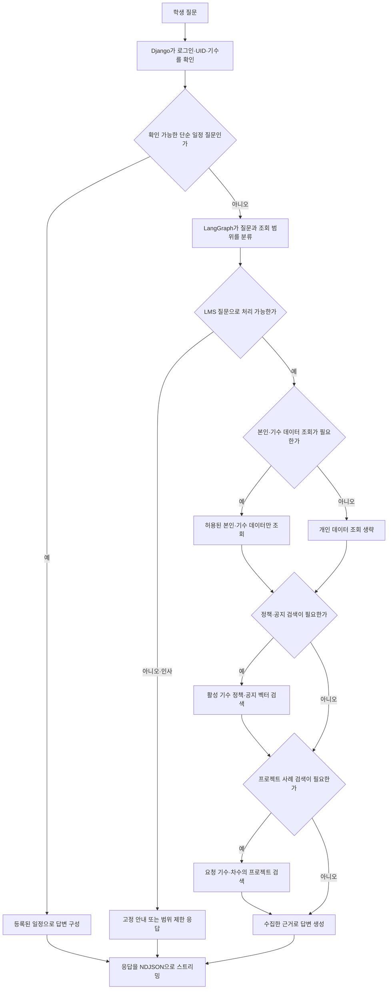

# 학생 챗봇

학생의 LMS 질문에 정책·공지·프로젝트 자료와 본인 학습 데이터를 근거로 답변한다.

## 입출력

| 항목 | 명세 |
| --- | --- |
| 사용자 | 로그인한 학생 |
| 입력 | 질문과 대화 문맥 |
| 근거 | 정책·FAQ, 소속 기수 공지, 전 기수 프로젝트, 본인 출결·이력서·학습 기록 및 접근 가능한 파일 |
| 출력 | 근거 기반 답변 또는 범위 안내, 스트리밍 응답 |

## 기능 흐름도

## 흐름 설명

1. Django가 로그인 세션에서 UID와 기수를 확인해 AI 서버에 전달한다. 학생이 보낸 UID·기수로 권한 범위를 바꾸지 않는다.
2. 일정 질문은 등록된 일정 자료로 답할 수 있으면 LLM과 벡터 검색 없이 처리한다. 그 외에는 LangGraph가 질문을 정책·공지·프로젝트·본인 데이터 범위로 분류한다.
3. 선택된 범위만 조회한다. 정책·공지는 로그인 기수로 제한하며 업로드 정책은 활성 문서를 우선 검색한다. 학생 데이터는 허용된 본인·기수 범위에서만 가져온다.
4. 출석률·수료 예상 등 계산값은 서버 제공 결과를 사용하고, 필요한 문서 근거를 답변에 연결해 NDJSON으로 스트리밍한다.

## 주요 규칙

- 본인 데이터와 접근 가능한 기수 자료만 조회한다. 비밀번호·토큰 등 민감한 값은 제외한다.
- 인사는 고정 응답으로 처리하며, LMS와 무관한 질문과 타인 개인정보 요청은 차단한다.
- 출석률은 서버에서 계산한다. 기록이 불완전하면 확정값과 진행 중 예상값을 구분한다.
- 정책·공지·업로드 문서의 본문은 참고 자료로만 취급한다. 문서 안의 지시문을 실행하지 않는다.

## 정책·공지 수집과 검색 범위

- 관리자가 기수에 정책 DOCX·PDF와 커리큘럼 PDF를 올리면 S3에 원본을 저장하고, 업로드별 Pinecone namespace에 적재한다. 전체 청크의 검색 가능 여부를 확인한 뒤 DB의 활성 문서 연결을 바꾼다.
- 정책 DOCX는 번호 제목 또는 장·조 구조를 읽는다. 조문은 조건·예외를 포함해 보존하고, 검색 후 같은 조문과 명시적으로 참조한 조문을 제한된 범위에서 보충한다. 웹 PDF 업로드는 텍스트를 추출하며, 텍스트를 읽지 못한 페이지가 있으면 등록을 중단한다.
- 정책과 공지 검색은 서버가 확인한 로그인 학생의 기수로 제한한다. 정책은 기수별 활성 업로드 namespace를 먼저 선택하고, 활성 업로드가 없으면 `policy` namespace에서 같은 기수 자료를 검색한다.
- 공지 첨부 이미지는 시각 모델로 문자를 추출하고 S3에 텍스트를 캐시한다. 표의 열 이름을 보존한 텍스트를 공지 본문과 함께 `notice` namespace에 적재한다. 이미지 자체를 벡터로 저장하는 방식은 아니다.
- 전 기수 프로젝트는 CSV의 기수·차수·GitHub 주소를 보존한다. 검색 대상 기수는 질문에서 정하며, 본인 소속 기수의 비공개 자료 접근 범위와 구분한다.

## 주요 API

| 메서드 | 웹 API | 용도 |
| --- | --- | --- |
| POST | `/api/chat` | 질문·답변 |
| POST | `/api/chat/stream` | 답변 스트리밍 |

## 구현 근거

- [질문 분류·검색·답변](../../chatbot/student_chatbot.py)
- [학생 데이터 조회](../../chatbot/firebase_student_context.py)
- [기수 문서 업로드](../../lms_api/lms/cohort_documents.py) · [활성 문서 검색](../../chatbot/cohort_document_rag.py)
- [정책 구조·청킹](../../vectordb/policy_ingestion.py) · [공지 이미지 추출·벡터 동기화](../../lms_api/lms/notice_vectors.py)
- [Django API](../../lms_api/lms/api.py)

[README로 돌아가기](../../README.md#features)
