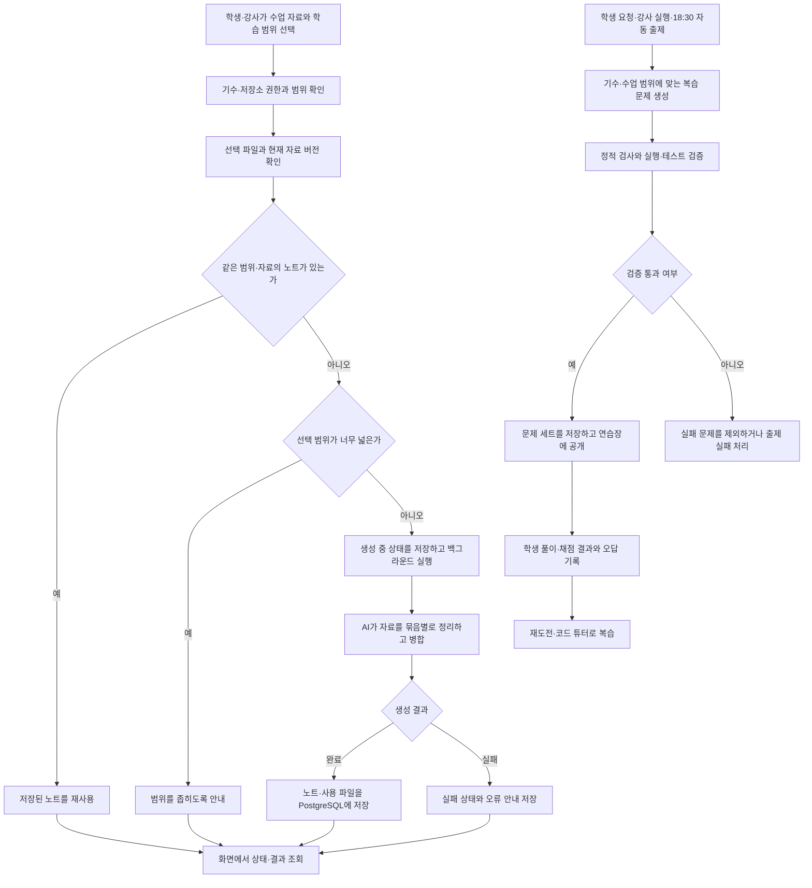

# 공부방 수업 노트·복습 문제

기수별 수업 자료를 학습 노트로 정리하고, 배운 내용을 복습할 문제를 생성한다.

## 입출력

| 항목 | 명세 |
| --- | --- |
| 사용자 | 학생, 수업 저장소·자동 출제 설정을 관리하는 강사·관리자 |
| 입력 | 등록된 GitHub 수업 저장소와 날짜·폴더·파일·주제 범위, 개인 노트 또는 실습 파일 |
| 근거 | 수업 자료의 코드·노트북·마크다운과 기존 출제 범위 |
| 출력 | 수업 노트, 정답·해설이 포함된 복습 문제, 생성 상태와 풀이 기록 |

## 기능 흐름도

## 흐름 설명

1. 서버가 사용자의 기수·역할과 수업 저장소 접근 권한을 확인한 뒤, 선택한 날짜·폴더·파일 범위의 자료를 해석한다.
2. 같은 수업 자료 버전과 범위로 생성된 노트가 있으면 재사용한다. 새 노트는 생성 중 상태를 먼저 기록한 뒤 백그라운드에서 만들며, 자료가 많으면 나누어 정리하고 병합한다.
3. 화면은 노트 상태를 조회해 완료된 결과를 표시한다. 범위가 너무 넓으면 사용자가 더 좁은 범위를 선택하도록 안내한다.
4. 복습 문제는 학생 요청·강사 실행 또는 매일 18:30 자동 출제로 만든다. 문제 검증기가 정적 검사와 해당 유형의 실행·테스트를 통과한 문제만 연습장에 공개한다.
5. 풀이와 채점 결과는 학습 기록에 남는다. 학생은 오답을 다시 풀고 코드 튜터에게 단계별 도움을 요청할 수 있다.

## 주요 규칙

- 학생·강사는 소속 기수 자료에 접근하며, 학생 개인 문제 세트는 본인만 조회한다.
- 노트 생성은 진행 상태를 먼저 반환하고, 화면에서 완료·실패 여부를 조회한다.
- 자동 출제는 기존 출제 범위를 이어서 처리한다. Celery beat는 매일 18:30(KST)에 실행한다.
- 개인 문제 생성은 요청당 6문제, 최근 24시간 기준 5회로 제한한다.
- 코드 문제는 실행 결과·테스트로 검증하고, 모델이 예상한 답만으로 확정하지 않는다.
- 노트·문제 생성은 선택한 수업 자료를 직접 문맥으로 사용한다. Pinecone 유사도 검색을 거치는 경로는 아니다.
- 노트 재사용 여부는 범위뿐 아니라 현재 자료 목록·내용 버전도 비교한다. 수업 자료가 바뀌면 기존 노트를 최신 자료로 다시 생성한다.

## 주요 API

| 메서드 | 웹 API | 용도 |
| --- | --- | --- |
| POST | `/api/study-notes/tree` | 수업 자료·범위 조회 |
| POST | `/api/study-notes` | 노트 생성·재사용 |
| GET | `/api/study-notes/{note_id}` | 생성 상태·노트 조회 |
| POST | `/api/practice-custom/note/{note_id}`, `/api/practice-custom/file` | 개인 복습 문제 생성 |

## 구현 근거

- [노트 생성·공유](../../lms_api/lms/study_note_service.py)
- [자동 출제](../../lms_api/lms/practice_auto.py) · [개인 출제](../../lms_api/lms/practice_custom.py)
- [자료 기반 생성](../../study_notes/pipeline.py) · [문제 검증](../../study_notes/practice/)

[README로 돌아가기](../../README.md#features)
